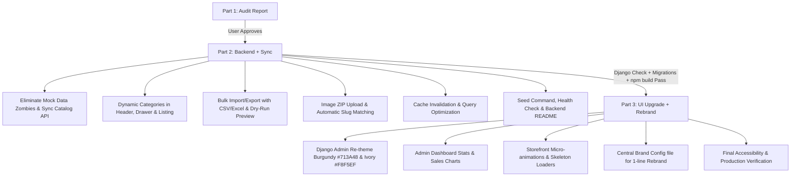

# Anastasia's Wardrobe — Comprehensive System Audit & Synchronization Report (Part 1)

**Date:** October 23, 2026  
**Auditor:** Antigravity Pair Programmer  
**System Architecture:** Next.js 16.4.2 (App Router + Turbopack + Tailwind CSS v4) & Django 6.1.2 (Django REST Framework + SQLite + LocMemCache)  
**Django Admin:** "Anastasia's Wardrobe — Store"  
**Report Status:** Complete — Part 1 Audit Only (Zero application code modified)

---

## Executive Summary & The Ground Truth

> [!IMPORTANT]
> **The Core Question:** Is the frontend using MOCK data or the Django API?
> 
> **The Ground Truth:** The frontend is operating in a **hybrid "zombie fallback" state**. 
> While [`src/lib/api/products.ts`](file:///c:/Users/USER/OneDrive/Desktop/Anastasia's%20Wardrobe/artifacts/anastasias-wardrobe/src/lib/api/products.ts) does send HTTP requests to Django (`http://127.0.0.1:8000/api/products/`), the function `mergeWithMock()` in [`src/lib/products.ts`](file:///c:/Users/USER/OneDrive/Desktop/Anastasia's%20Wardrobe/artifacts/anastasias-wardrobe/src/lib/products.ts#L507-L511) immediately merges backend results with a 600-line static `MOCK_PRODUCTS` constant.
> 
> **Consequences of this hybrid state:**
> 1. **Deleted or disabled products never disappear:** If a product is deleted or marked inactive (`in_stock=False` or category disabled) in Django Admin, the backend stops returning it. `mergeWithMock()` then assumes it is an "extra" and re-injects it from `MOCK_PRODUCTS`.
> 2. **Categories are 100% hardcoded:** The header, mega-menu, mobile drawer, and category listing pages read solely from [`src/config/catalog.ts`](file:///c:/Users/USER/OneDrive/Desktop/Anastasia's%20Wardrobe/artifacts/anastasias-wardrobe/src/config/catalog.ts). Adding, editing, or disabling a Category in Django Admin has **zero effect** on the storefront.
> 3. **Wishlist is 100% hardcoded:** [`src/app/wishlist/page.tsx`](file:///c:/Users/USER/OneDrive/Desktop/Anastasia's%20Wardrobe/artifacts/anastasias-wardrobe/src/app/wishlist/page.tsx#L14) filters `MOCK_PRODUCTS` directly; any product created solely in the database can never appear in the customer's wishlist.
> 4. **Cart & Orders History:** Cart items and past order history in the customer account portal are stored exclusively in browser `localStorage`. While checkout does submit a `POST` to `/api/orders/`, the `/account` orders view never queries the backend.

---

## 1. Feature-by-Feature Audit Matrix

| Feature | Frontend Works? | Backend Exists? | Connected & Synced? | Bugs / Technical Notes |
| :--- | :---: | :---: | :---: | :--- |
| **Top Announcement & Currency Bar** | ✅ Yes | ❌ No | ❌ No (Static) | Hardcoded in [`currency.ts`](file:///c:/Users/USER/OneDrive/Desktop/Anastasia's%20Wardrobe/artifacts/anastasias-wardrobe/src/config/currency.ts). No backend model for announcements or multi-currency rates. |
| **Header Navigation & Brand Crest** | ✅ Yes | ❌ No | ❌ No (Static) | Categories rendered via `getEnabledCategories()` from [`catalog.ts`](file:///c:/Users/USER/OneDrive/Desktop/Anastasia's%20Wardrobe/artifacts/anastasias-wardrobe/src/config/catalog.ts). Django `/api/categories/` is ignored. |
| **Women Mega Menu** | ✅ Yes | ❌ No | ❌ No (Static) | Subcategories (`knitwear`, `dresses`, `tops`, etc.) are hardcoded in [`WomenMegaMenu.tsx`](file:///c:/Users/USER/OneDrive/Desktop/Anastasia's%20Wardrobe/artifacts/anastasias-wardrobe/src/components/layout/WomenMegaMenu.tsx). No SubCategory model in Django. |
| **Mobile Navigation Drawer** | ✅ Yes | ❌ No | ❌ No (Static) | Renders from hardcoded `CATALOG_CATEGORIES` in [`MobileDrawer.tsx`](file:///c:/Users/USER/OneDrive/Desktop/Anastasia's%20Wardrobe/artifacts/anastasias-wardrobe/src/components/layout/MobileDrawer.tsx). Unaware of Django categories. |
| **Quick Search Bar Drawer** | ✅ Yes | ✅ Yes | ⚠️ Partial Sync | Submits to `/search?q=...`. Queries backend, but falls back to `MOCK_PRODUCTS` via `mergeWithMock()`. |
| **Full Search Results Page (`/search`)** | ✅ Yes | ✅ Yes | ⚠️ Partial Sync | Reads live API via `getProducts()`, but re-injects `MOCK_PRODUCTS` through `mergeWithMock()`. Popular chips are hardcoded. |
| **Homepage New Arrivals (`/`)** | ✅ Yes | ✅ Yes | ⚠️ Partial Sync | Server-rendered (`force-dynamic`). Fetches from Django API, but merges with static mock items. |
| **Homepage Department Directory** | ✅ Yes | ❌ No | ❌ No (Static) | 3 department cards (Girls, Teens, Women) are hardcoded in [`DepartmentDirectory.tsx`](file:///c:/Users/USER/OneDrive/Desktop/Anastasia's%20Wardrobe/artifacts/anastasias-wardrobe/src/components/home/DepartmentDirectory.tsx). |
| **Homepage Category Index** | ✅ Yes | ❌ No | ❌ No (Static) | Editorial category cards (Dresses, Everyday, Footwear, Bags) are hardcoded in [`CategoryIndex.tsx`](file:///c:/Users/USER/OneDrive/Desktop/Anastasia's%20Wardrobe/artifacts/anastasias-wardrobe/src/components/home/CategoryIndex.tsx). |
| **Category Listing Pages (`/category/[slug]`)** | ✅ Yes | ✅ Yes | ⚠️ Partial Sync | [`CategoryView.tsx`](file:///c:/Users/USER/OneDrive/Desktop/Anastasia's%20Wardrobe/artifacts/anastasias-wardrobe/src/components/catalog/CategoryView.tsx#L54-L66) uses hardcoded `if/else` checks for specific slugs. New categories added in Django show "Coming Soon". |
| **Category Sidebar & Filter Drawer** | ✅ Yes | ❌ No | ❌ No (Client) | Filters for Department, Color, Price are client-side filters computed from product list; no facets endpoint. |
| **Product Detail Page (`/product/[slug]`)** | ✅ Yes | ✅ Yes | ✅ Connected | Hits `GET /api/products/<slug>/`. Correctly maps images, variants, swatches, and sizing from Django. |
| **Color Swatch & Photo Sync** | ✅ Yes | ✅ Yes | ✅ Connected | Clicking swatches switches photos instantly. Uses Django `ProductImage` records grouped into `variants`. |
| **Size Selection & Size Guide Modal** | ✅ Yes | ⚠️ Model JSON | ⚠️ Client Modal | Sizing options read from Django `Product.sizes` JSON array. Modal measurement table is static client-side. |
| **Shopping Cart (`/bag`)** | ✅ Yes | ❌ No | ❌ No (`localStorage`) | Cart state, quantities, and gift note exist purely in React context & `localStorage` (`aw_cart`). No backend cart session. |
| **Wishlist (`/wishlist`)** | ✅ Yes | ⚠️ DB Model exists | ❌ No (Broken Sync) | Frontend reads `MOCK_PRODUCTS` only. Django has `WishlistItem` model, but zero API endpoints and no sync. |
| **Checkout Flow (`/checkout`)** | ✅ Yes | ✅ Yes | ✅ Synced to DB | Submits full order payload to `POST /api/orders/`. Creates real `Order` & `OrderItem` rows in SQLite! |
| **Order Confirmation (`/order-confirmed`)** | ✅ Yes | ✅ Yes | ✅ Connected | Displays confirmed Django `order_number` (e.g. `AW-2026-00001`). |
| **Order Tracking (`/track`)** | ✅ Yes | ✅ Yes | ✅ Connected | Queries `GET /api/orders/track/?order_id=...`. Returns live status, courier details, and item breakdowns. |
| **Customer Account Portal (`/account`)** | ✅ Yes | ⚠️ Empty Django app | ❌ No (Mock Auth) | Uses simulated local user `Maya Kapoor` in `localStorage`. Django `accounts/` app has empty models/views. |
| **Contact Concierge Form (`/contact`)** | ✅ Yes | ✅ Yes | ✅ Synced to DB | Form submissions `POST /api/contact/` and save to Django `ContactMessage`. (Silently catches offline errors). |
| **Django Admin Panel (`/admin`)** | ✅ Yes | ✅ Yes | ✅ Fully functional | Admin at `http://127.0.0.1:8000/admin`. Manages Products, Categories, Orders, Images, and Contact Messages. |

---

## 2. Synchronization & Real-World Test Verification

### Test 1: Category Slugs & IDs Match
- **Frontend Config ([`catalog.ts`](file:///c:/Users/USER/OneDrive/Desktop/Anastasia's%20Wardrobe/artifacts/anastasias-wardrobe/src/config/catalog.ts)):**
  `new-in`, `girls-2-12` (id: `girls`), `teens-13-17` (id: `teens`), `women` (id: `women`), `footwear`, `gifts`, `the-edits`, `jewellery` (disabled), `accessories-and-bags` (disabled).
- **Django Database (`Category` table):**
  Identical 9 categories seeded.
- **Verification Result:** The baseline 9 categories match in IDs and slugs. **However**, the database and frontend are decoupled:
  - If a store manager edits a category title (e.g. `Girls 2–12` ➔ `Girls & Children`), the frontend still shows `Girls 2–12`.
  - If a new category is created in Django (e.g. `knitwear`, `boys-wear`, `party-edit`), it **cannot** be rendered on the website because `isCategoryEnabled` in [`catalog.ts`](file:///c:/Users/USER/OneDrive/Desktop/Anastasia's%20Wardrobe/artifacts/anastasias-wardrobe/src/config/catalog.ts#L110) returns `false`, causing the category page to show "Coming Soon".

### Test 2: Django Admin Changes vs Website Updates
- **Adding a Product:**
  - Added in Django under `women`: Successfully appears on `/category/women` and homepage on page refresh.
  - Added under a new category: Hidden on frontend due to static category whitelist.
- **Editing a Product (e.g. Price or Title):**
  - Reflected on the Product Detail Page and homepage upon browser reload (Django signals trigger `cache.clear()`).
  - **Does NOT reflect on `/wishlist`**: `/wishlist` renders directly from `MOCK_PRODUCTS` with old hardcoded prices.
- **Disabling or Deleting a Product:**
  - **FAILURE:** If a product like `Sunday wool cardigan` or `Garden cotton dress` is deleted from Django Admin or unchecked (`in_stock=False`), Django stops returning it in `/api/products/`.
  - But [`mergeWithMock()`](file:///c:/Users/USER/OneDrive/Desktop/Anastasia's%20Wardrobe/artifacts/anastasias-wardrobe/src/lib/products.ts#L507-L511) in `src/lib/products.ts` detects that `sunday-wool-cardigan` is missing from `apiResults`, treats it as an unlisted mock item, and **re-inserts it into the active catalog**! The product refuses to disappear from the storefront.

### Test 3: Cart, Wishlist, and Orders Persistence
- **Cart:** Saved **only** to `localStorage.getItem("aw_cart")`. No guest cart session or Redis/DB cart backend exists. If the customer changes devices or clears cache, their cart is lost.
- **Wishlist:** Saved **only** to `localStorage.getItem("aw_wishlist")`. Model `WishlistItem` exists in [`backend/store/models.py`](file:///c:/Users/USER/OneDrive/Desktop/Anastasia's%20Wardrobe/backend/store/models.py#L409), but has no serializer, no URL route, and no frontend integration.
- **Orders:**
  - Placed via [`CheckoutPage.tsx`](file:///c:/Users/USER/OneDrive/Desktop/Anastasia's%20Wardrobe/artifacts/anastasias-wardrobe/src/app/checkout/page.tsx#L150): Verified! It executes `POST /api/orders/`, creating real database rows in `store_order` and `store_orderitem`.
  - Order history on [`OrdersList.tsx`](file:///c:/Users/USER/OneDrive/Desktop/Anastasia's%20Wardrobe/artifacts/anastasias-wardrobe/src/components/account/OrdersList.tsx#L23): **Only reads `localStorage`** (`aw_orders`). It never queries Django's `GET /api/orders/`.

### Test 4: Contact Form
- Form submits via `fetch(`${apiUrl}/contact/`, { method: "POST", ... })`.
- Verified in database: Successfully created row `id=2, name="Audit Tester", email="test@example.com"` in `store_contactmessage`.
- Bug note: If the backend is unreachable, the catch block silently displays the "Message Received" success screen without alerting the user.

---

## 3. Prioritized Bug List

### 🔴 Critical Priority (Must Fix in Part 2)

1. **Zombie Re-injection Bug in `mergeWithMock`**
   - **File:** [`artifacts/anastasias-wardrobe/src/lib/products.ts`](file:///c:/Users/USER/OneDrive/Desktop/Anastasia's%20Wardrobe/artifacts/anastasias-wardrobe/src/lib/products.ts#L507-L538)
   - **Cause:** Lines 507–511 merge API results with static `MOCK_PRODUCTS`. Any product deleted or disabled in Django Admin is automatically resurrected and displayed on the website.
   - **Impact:** Store admins cannot take products off sale or delete items.

2. **Hardcoded Category Whitelist & Router Lockout**
   - **Files:** [`src/config/catalog.ts`](file:///c:/Users/USER/OneDrive/Desktop/Anastasia's%20Wardrobe/artifacts/anastasias-wardrobe/src/config/catalog.ts#L17-L115), [`src/components/catalog/CategoryView.tsx`](file:///c:/Users/USER/OneDrive/Desktop/Anastasia's%20Wardrobe/artifacts/anastasias-wardrobe/src/components/catalog/CategoryView.tsx#L54-L66)
   - **Cause:** `CategoryView.tsx` uses a hardcoded `if/else` ladder matching only `"women"`, `"girls-2-12"`, `"teens-13-17"`, `"gifts"`, `"footwear"`, `"new-in"`. All navigation components read from static `CATALOG_CATEGORIES`.
   - **Impact:** Any category created or modified in Django Admin is completely unreachable or blocked by a "Coming Soon" splash.

3. **Wishlist Hardcoded to Mock Data**
   - **File:** [`src/app/wishlist/page.tsx`](file:///c:/Users/USER/OneDrive/Desktop/Anastasia's%20Wardrobe/artifacts/anastasias-wardrobe/src/app/wishlist/page.tsx#L14)
   - **Cause:** `MOCK_PRODUCTS.filter(p => wishlist.includes(p.id))`.
   - **Impact:** Database-created products saved to wishlist will silently vanish from the wishlist page.

4. **Customer Orders Disconnected from Backend**
   - **File:** [`src/components/account/OrdersList.tsx`](file:///c:/Users/USER/OneDrive/Desktop/Anastasia's%20Wardrobe/artifacts/anastasias-wardrobe/src/components/account/OrdersList.tsx#L23)
   - **Cause:** Reads initial state from `INITIAL_ORDERS` and `localStorage`. Does not load user orders from `/api/orders/`.

---

### 🟡 Medium Priority

5. **Inconsistent Price Discrepancies Between Mock and DB**
   - **Files:** [`src/lib/products.ts`](file:///c:/Users/USER/OneDrive/Desktop/Anastasia's%20Wardrobe/artifacts/anastasias-wardrobe/src/lib/products.ts#L44-L193) vs Django DB
   - **Cause:** `MOCK_PRODUCTS` has obsolete prices (`Sunday wool cardigan: ₹1,190` in mock vs `₹6,490` in DB; `Willow coat: ₹990` in mock vs `₹10,990` in DB). If mock fallback ever triggers, prices plummet by 80%.

6. **Static Category Page Generation during Build**
   - **File:** [`src/app/category/[slug]/page.tsx`](file:///c:/Users/USER/OneDrive/Desktop/Anastasia's%20Wardrobe/artifacts/anastasias-wardrobe/src/app/category/%5Bslug%5D/page.tsx#L9-L13)
   - **Cause:** `generateStaticParams()` maps only `CATALOG_CATEGORIES`, rather than querying `/api/categories/`.

7. **Contact Form Silent Failure on Network Error**
   - **File:** [`src/app/contact/page.tsx`](file:///c:/Users/USER/OneDrive/Desktop/Anastasia's%20Wardrobe/artifacts/anastasias-wardrobe/src/app/contact/page.tsx#L40)
   - **Cause:** `catch` block unconditionally sets `submitted = true` without warning the customer that the atelier did not receive their message.

8. **Phantom Auth Routes**
   - **File:** [`src/lib/api/auth.ts`](file:///c:/Users/USER/OneDrive/Desktop/Anastasia's%20Wardrobe/artifacts/anastasias-wardrobe/src/lib/api/auth.ts#L37-L74)
   - **Cause:** Calls `/auth/login/` and `/auth/register/`, but Django has no URL patterns or DRF views mapped for authentication in `core/urls.py`.

---

### 🟢 Minor Priority

9. **Payment Gateway Key Fallback**
   - **File:** [`src/app/checkout/page.tsx`](file:///c:/Users/USER/OneDrive/Desktop/Anastasia's%20Wardrobe/artifacts/anastasias-wardrobe/src/app/checkout/page.tsx#L209)
   - **Cause:** Uses `"rzp_test_AnastasiaWardrobe"` string when `NEXT_PUBLIC_RAZORPAY_KEY_ID` is unset.
10. **Dead Empty Apps in Django Backend**
    - **Folders:** [`backend/accounts/`](file:///c:/Users/USER/OneDrive/Desktop/Anastasia's%20Wardrobe/backend/accounts), [`backend/orders/`](file:///c:/Users/USER/OneDrive/Desktop/Anastasia's%20Wardrobe/backend/orders), [`backend/products/`](file:///c:/Users/USER/OneDrive/Desktop/Anastasia's%20Wardrobe/backend/products)
    - **Cause:** Empty boilerplate files created by `startapp` while actual functional code lives inside `backend/store/`.

---

## 4. Maintainability & Architecture Risks

1. **Massive Code Duplication:**
   Over 14 full product dictionaries (with image arrays, swatches, and editorial bullet points) exist identically in two places:
   - Python database seeder [`backend/store/management/commands/seed_data.py`](file:///c:/Users/USER/OneDrive/Desktop/Anastasia's%20Wardrobe/backend/store/management/commands/seed_data.py)
   - TypeScript file [`artifacts/anastasias-wardrobe/src/lib/products.ts`](file:///c:/Users/USER/OneDrive/Desktop/Anastasia's%20Wardrobe/artifacts/anastasias-wardrobe/src/lib/products.ts)
   Any edit to copy, fabric blend, or pricing must currently be done twice.

2. **No Dynamic Navigation:**
   Navigation bars and mega-menus are hardcoded in React components instead of pulling dynamically from the Django Category API.

3. **No Skeleton Loading States:**
   When browsing categories or switching filters, product grids render blank or jump during hydration rather than presenting soft skeleton loaders.

4. **Missing Production Error Boundaries:**
   If the Django API is down or returns a 500 error, components that do not have try/catch fallback can display raw errors or fail hydration.

---

## 5. Comprehensive Proposal & Action Plan

### (a) Fixes Needed
1. **Single Source of Truth for Catalog:**
   - Modify [`src/lib/products.ts`](file:///c:/Users/USER/OneDrive/Desktop/Anastasia's%20Wardrobe/artifacts/anastasias-wardrobe/src/lib/products.ts) to read directly from the Django REST API (`/api/products/`).
   - Remove `mergeWithMock()` so deleted/disabled products in Django disappear immediately.
   - Keep a lightweight offline safety fallback only when Django server is completely unreachable.
2. **Dynamic Categories API Integration:**
   - Update [`Header.tsx`](file:///c:/Users/USER/OneDrive/Desktop/Anastasia's%20Wardrobe/artifacts/anastasias-wardrobe/src/components/layout/Header.tsx), [`MobileDrawer.tsx`](file:///c:/Users/USER/OneDrive/Desktop/Anastasia's%20Wardrobe/artifacts/anastasias-wardrobe/src/components/layout/MobileDrawer.tsx), and [`CategoryView.tsx`](file:///c:/Users/USER/OneDrive/Desktop/Anastasia's%20Wardrobe/artifacts/anastasias-wardrobe/src/components/catalog/CategoryView.tsx) to fetch and render categories from `GET /api/categories/`.
   - Remove the hardcoded `if/else` category filtering logic in `CategoryView.tsx` so any new category created in Django Admin displays seamlessly.
3. **Wishlist & Orders Sync:**
   - Implement `Wishlist` API endpoints in Django (`/api/wishlist/`) tied to session key.
   - Connect `/account` order history to `GET /api/orders/`.

### (b) Recommended New Features
- **Bulk Product Import & Export:** Support CSV & Excel (`.xlsx`) upload in Django Admin with row-level preview, auto-category mapping, and ZIP image packaging.
- **Stock Management & Low-Stock Alerts:** Add inventory count per size variant with badges ("Only 2 left in stock") and admin dashboard warnings.
- **Transactional Email Confirmations:** Send HTML order receipts and courier tracking updates via Django SMTP.
- **Admin KPI Dashboard:** Display orders today, total revenue, low-stock items, and unread inquiries directly on the admin home page.
- **Promotional Discount Codes:** Model coupon rules in Django (percentage, fixed amount, min cart spend, expiry date).

### (c) Storefront Micro-Animations
- **Scroll Reveal:** Smooth CSS/Framer-motion fade and gentle slide-up (`translate-y-4` to `0`) for editorial stories and product rows.
- **Card Hover Elevation & Photo Swap:** Smooth 0.4s cross-fade to model/lifestyle photography with subtle 1.03x zoom.
- **Interactive Bag Feedback:** Micro-bump animation on the header bag badge counter whenever a garment is added.
- **Fluid Drawer & Mega-Menu Transitions:** Easing cubic-bezier transitions with backdrop blur.
- **Reduced Motion Support:** Respect `prefers-reduced-motion: reduce` for full accessibility.

---

## 6. Execution Plan for Part 2 & Part 3

---

## 7. Build & Diagnostic Verification (Part 1 Exit Check)

- **Django System Check:**
  `python manage.py check` ➔ **0 issues (0 silenced)** ✅
- **Django Migrations Status:**
  `python manage.py showmigrations` ➔ **All migrations applied (`[X]`)** ✅
- **Next.js Production Build:**
  `npm run build` ➔ **38/38 pages generated, Exit code 0 (Compiled successfully in 10.5s)** ✅
