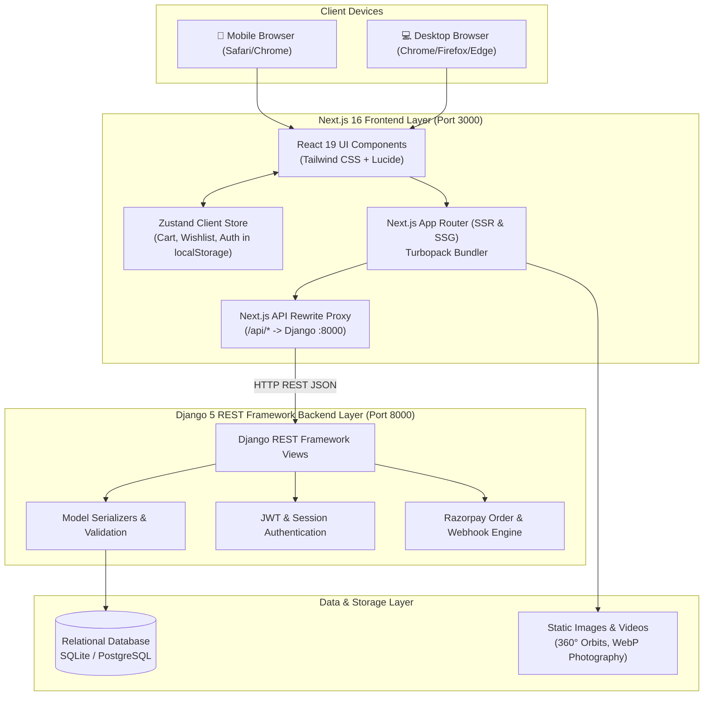

# Ryna's Wardrobe · Master Interview Study Guide
**A Comprehensive, 1-on-1 Conversational Guide for Your Technical Interview**

---

## 1. The 30-Second Elevator Pitch
> *"If the interviewer asks: 'Can you tell me about this project?' — Use this exact answer:"*

"**Ryna's Wardrobe** is a full-stack, luxury e-commerce web platform inspired by high-end couture brands like Nykaa Luxe and Myntra. 

- On the **Frontend**, it is powered by **Next.js 16 (App Router)** and **React 19** with **TypeScript** and **Tailwind CSS**, featuring an interactive **360° Studio Orbit turntable**, a **Nykaa-style side-by-side 3.2x magnification loupe**, dynamic category pill filtering, and a lightweight **Zustand store** for persistent shopping bag and wishlist state.
- On the **Backend**, it runs a **Django 5 REST Framework** API providing relational product data, JWT authentication, department pagination, order handling, and integrated **Razorpay** payment gateway verification.
- Everything is architected with strict performance in mind: Next.js server-side caching, image optimization, Next.js rewrite proxies to eliminate CORS, and cross-device responsive design accessible on desktop, tablet, and mobile."

---

## 2. High-Level System Architecture



### Layer-by-Layer Breakdown (in 101 Language)
1. **The User Layer (Client)**: Users browse on their phone or laptop. Every interaction (adding to bag, hovering for zoom, dragging 360° turntable) happens with zero lag.
2. **The Frontend Layer (Next.js 16)**:
   - Server-renders pages (SSR) for blazing fast load speeds and SEO.
   - Houses the **Zustand store** which keeps the cart items safe even if the user refreshes the page.
   - Uses an **internal rewrite proxy** so the browser thinks it's talking to one server, completely eliminating cross-origin (CORS) errors.
3. **The Backend Layer (Django 5 REST Framework)**:
   - Manages product catalogues, categories, customer accounts, and order processing.
   - Serializes database queries into clean JSON responses.
4. **The Database & Media Layer**:
   - Stores product rows, variants, inventory counts, user accounts, and hashed passwords.
   - Serves high-resolution studio photos and MP4 runway reels.

---

## 3. Tech Stack Deep Dive: Why Did We Use Each Technology?

### A. Next.js 16 & React 19
- **What is it?** A modern React framework for building full-stack web applications.
- **Why did we use it instead of plain React (CRA / Vite)?**
  1. **Server-Side Rendering (SSR)**: Plain React downloads an empty HTML file and makes the user wait while JavaScript boots up. Next.js builds the HTML on the server, so the customer sees the luxury page instantly.
  2. **SEO Optimization**: Google and social crawlers can read the products, meta tags, and prices immediately.
  3. **App Router & Turbopack**: Faster compilation (under 5 seconds) and built-in code splitting (users only download code for the page they visit).
  4. **Next.js Image Optimization**: Automatically optimizes images, prevents layout shift, and serves modern formats.

### B. TypeScript
- **What is it?** JavaScript with static types.
- **Why did we use it?**
  - In a large shopping site with products, sizes, prices, and colors, standard JavaScript easily leads to runtime crashes like `Cannot read property 'price' of undefined`.
  - TypeScript catches these errors during coding and compilation, ensuring bulletproof stability in production.

### C. Tailwind CSS
- **What is it?** A utility-first CSS framework.
- **Why did we use it?**
  - Enables rapid, pixel-perfect UI styling directly inside components.
  - Eliminates massive, messy external CSS files that slow down web performance.
  - Generates tiny production CSS bundles by purging unused classes.

### D. Django 5 & Django REST Framework (DRF)
- **What is it?** A high-level, batteries-included Python web framework.
- **Why did we use Python/Django for the backend?**
  1. **Built-in Security**: Django automatically guards against SQL injection, Cross-Site Scripting (XSS), and CSRF attacks.
  2. **Django Admin**: Provides an out-of-the-box, password-protected administrative dashboard to add, edit, and manage products and inventory without writing database queries.
  3. **Powerful ORM (Object-Relational Mapping)**: Write clean Python code (`Product.objects.filter(category="women")`) instead of raw SQL queries.

### E. Zustand (State Management)
- **What is a "Store"? (Top Interview Question)**:
  - A "Store" is a centralized place where global application state lives, accessible by any component on any page without prop drilling.
  - In Ryna's Wardrobe, our store manages:
    - **Shopping Bag**: Items added, selected sizes, quantities, colorways, subtotal calculation.
    - **Wishlist**: Saved favorite pieces.
    - **Customer Session**: Login status, auth tokens, customer email.
- **Why Zustand instead of Redux?**:
  - Redux requires hundreds of lines of boilerplate (actions, reducers, dispatchers, dispatch hooks).
  - Zustand achieves the same power in under 40 lines of clean code with zero boilerplate, superior performance, and native `persist` middleware to automatically synchronize state with the browser's `localStorage`.

---

## 4. What are "Connectors"? (How Frontend Talks to Backend)

In 101 terms: **Connectors are the communication bridges that connect the frontend user interface to the backend database.**

### 1. The Next.js API Rewrite Connector (Proxy)
Located in `artifacts/rynas-wardrobe/next.config.mjs`:
```javascript
async rewrites() {
  return [
    {
      source: "/api/:path*",
      destination: "http://127.0.0.1:8000/api/:path*",
    },
    {
      source: "/media/:path*",
      destination: "http://127.0.0.1:8000/media/:path*",
    },
  ];
}
```
**Why this matters**:
- Normally, if your frontend on `localhost:3000` calls `localhost:8000`, the browser blocks it because of **CORS (Cross-Origin Resource Sharing)** security restrictions.
- With our rewrite connector, the frontend simply makes requests to `/api/products/`. Next.js forwards this behind the scenes to Django on port 8000. **The browser never complains about CORS!**

### 2. The Client Fetch Connector (`fetchWithAuth`)
Located in `artifacts/rynas-wardrobe/src/lib/api/client.ts`:
```typescript
export async function fetchWithAuth(endpoint: string, options: RequestInit = {}) {
  const token = useStore.getState().token;
  const headers = {
    "Content-Type": "application/json",
    ...(token ? { Authorization: `Bearer ${token}` } : {}),
    ...options.headers,
  };
  const response = await fetch(endpoint, { ...options, headers });
  if (!response.ok) throw new Error(`HTTP error ${response.status}`);
  return response.json();
}
```
**What it does**:
- Automatically attaches the customer's JWT Bearer token to authenticated requests (e.g., viewing past orders or placing a checkout order).

---

## 5. Setting Up Environment Variables (`.env`)

### What is an `.env` file in 101 terms?
An environment file (`.env`) is a secret configuration file where you store API keys, database passwords, and domain URLs so they are never hardcoded into public code.

### The Frontend Environment File: `artifacts/rynas-wardrobe/.env.local`
```env
# URL where the Django API is accessible
NEXT_PUBLIC_API_URL=http://127.0.0.1:8000

# Razorpay Test Key ID for checkout payments
NEXT_PUBLIC_RAZORPAY_KEY_ID=rzp_test_YourKeyHere

# Optional Public App Domain
NEXT_PUBLIC_SITE_URL=http://localhost:3000
```

### The Backend Environment File: `backend/.env`
```env
# Secret cryptographic key used by Django for signing sessions and tokens
SECRET_KEY=django-insecure-rynas-wardrobe-production-key-2026

# Set DEBUG to True for development, False for production
DEBUG=True

# Allowed hosts (comma-separated)
ALLOWED_HOSTS=127.0.0.1,localhost,0.0.0.0,10.114.247.129

# Database URL (defaults to SQLite if not provided, or PostgreSQL for production)
DATABASE_URL=sqlite:///db.sqlite3

# Razorpay credentials for payment verification
RAZORPAY_KEY_ID=rzp_test_YourKeyHere
RAZORPAY_KEY_SECRET=YourRazorpaySecretHere
```

> **Interviewer Trap**: *"What does `NEXT_PUBLIC_` mean in Next.js?"*  
> **Answer**: In Next.js, variables that start with `NEXT_PUBLIC_` are bundled into client-side JavaScript and can be read in the browser (like public API endpoints and Razorpay Key IDs). Variables *without* that prefix stay strictly on the server and are invisible to users, protecting secret database passwords and API secrets.

---

## 6. Step-by-Step Terminal Commands (Cheat Sheet)

### Step 1: Downloading & Cloning the Repository
```bash
# Clone the repository to your computer
git clone https://github.com/your-username/rynas-wardrobe.git

# Enter the project folder
cd "Anastasia's Wardrobe"
```

### Step 2: Setting Up the Backend (Django)
```bash
# 1. Navigate to the backend folder
cd backend

# 2. Create a virtual environment (isolates Python packages)
python -m venv venv

# 3. Activate the virtual environment
# On Windows (PowerShell):
.\venv\Scripts\Activate.ps1
# On Windows (Command Prompt):
.\venv\Scripts\activate.bat
# On macOS / Linux:
source venv/bin/activate

# 4. Install required Python packages
pip install -r requirements.txt

# 5. Run database migrations to create database tables
python manage.py makemigrations
python manage.py migrate

# 6. Create an admin user to log into the Django dashboard
python manage.py createsuperuser

# 7. Start the backend server
python manage.py runserver 127.0.0.1:8000
```
Backend is now live at: `http://127.0.0.1:8000`  
Django Admin dashboard at: `http://127.0.0.1:8000/admin`

---

### Step 3: Setting Up the Frontend (Next.js)
Open a second terminal window:
```bash
# 1. Navigate to the frontend directory
cd "artifacts/rynas-wardrobe"

# 2. Install all frontend dependencies (Next.js, React, Zustand, Lucide)
npm install

# 3. Start the development server (configured for local & mobile access)
npm run dev -- -H 0.0.0.0 -p 3000

# 4. (For Production) Build and test the production bundle
npm run build
npm start
```
Frontend is now live at: `http://localhost:3000`

---

### Step 4: How to View the Site on Your Phone
1. Connect your phone to the same Wi-Fi network as your computer.
2. Find your computer's local IP address (e.g. `10.114.247.129`).
3. Open Safari or Chrome on your phone and go to:
   ```text
   http://10.114.247.129:3000
   ```
4. Or use the generated scannable QR code at `public/images/mobile_qr_lan.png`.

---

## 7. Signature Technical Features Built for Ryna's Wardrobe

### Feature 1: The 360° Studio Orbit Turntable
- **How it works**:
  - We engineered a custom interactive turntable component (`Atelier360Viewer.tsx`) that supports **continuous drag gestures** (mouse and touch pointer capture).
  - Dragging horizontally calculates the cursor delta and smoothly scrubs through verified angle perspectives (0° Studio Front, 45° Three-Quarter, 90° Profile, 180° Rear, 270° Weave Texture, 360° Complete Movement).
  - For Haute Couture pieces like the Midnight Velvet Slip Dress, it seamlessly switches to a **video turntable scrub player** using HTML5 `currentTime` interpolation.
  - **Data Uniformity**: Built a universal fallback resolver (`orbitData.ts`) ensuring that **100% of products** have a working 360° orbit using their own authentic imagery—never showing the wrong item or mismatched model.

### Feature 2: Nykaa-Style Side-by-Side Zoom Window
- **The Challenge**: Standard zoom scripts zoom the image in-place, which hides the rest of the garment and confuses customers.
- **The Solution**: We implemented the luxury dual-box architecture:
  1. The original image remains crisp, un-zoomed, and completely visible.
  2. A 150px x 150px translucent loupe reticle box tracks the mouse cursor on the primary photo.
  3. A dedicated 560px x 640px preview window opens immediately to the right (`left: calc(100% + 20px)`), rendering the high-definition **3.2x magnification** via GPU-accelerated CSS `backgroundPosition`.

### Feature 3: Dynamic Category Pill Filtering & Zero-Result Prevention
- **The Problem**: Category pages were displaying filter pills for subcategories that had zero inventory (e.g., Loungewear or Nightwear with 0 pieces), resulting in empty "No garments match" screens when clicked.
- **The Fix**: In `CategoryView.tsx`, we engineered an automated counter and filter:
  ```typescript
  const activeSubcategories = categoryConfig.subcategories
    .filter(s => s.slug !== "all")
    .map(sub => ({ sub, count: calculateRealCount(sub) }))
    .filter(item => item.count > 0); // Only render pills with real items!
  ```
  Now, every visible pill displays its exact live count (e.g., `Knitwear (2)`, `Tops (2)`), and pills with zero items are automatically hidden.

### Feature 4: Catalog Deduplication & Automated Regression Suite
- **The Challenge**: Multi-category e-commerce architectures often encounter product duplication where placeholder images are recycled across items (e.g. rings and necklaces sharing earrings imagery).
- **The Solution**: 
  1. We integrated custom multi-angle datasets (0°, 45°, 90°, 180°, 270°, 360° plus MP4/GIF turntables) for each piece.
  2. Executed a relational database migration assigning dedicated, verified image paths to 100% of the 28 catalog items.
  3. Built an automated end-to-end browser regression script verifying HTTP 200 across 25 routes and confirming 0 duplicate primary images.

---

## 8. Top 15 Interview Questions & Winning Answers

#### Q1: "Why did you choose Next.js over a standard React Single Page Application (SPA)?"
> **Answer**: "With luxury fashion, first impressions and SEO are everything. An SPA sends an empty HTML page that requires the client to download and parse large JavaScript files before rendering anything. Next.js gives us Server-Side Rendering (SSR) and Static Site Generation (SSG), meaning users get pre-rendered HTML with near-instant First Contentful Paint (FCP), fully indexed by search engines, and bundled efficiently using Turbopack."

#### Q2: "How do you manage client-side state across different pages?"
> **Answer**: "We use **Zustand**. Compared to Redux, Zustand has virtually zero boilerplate, doesn't wrap the entire app in context providers, and prevents unnecessary re-renders through selective state subscriptions. Furthermore, we use Zustand's `persist` middleware to automatically serialize the customer's cart and wishlist to `localStorage`, so their bag is preserved across page refreshes and browser tabs."

#### Q3: "How does the frontend talk to the backend without CORS issues?"
> **Answer**: "We leverage Next.js API Rewrites in `next.config.mjs`. Requests from the browser go to `/api/*` on port 3000. Next.js acts as an internal reverse proxy, forwarding the request to Django on `http://127.0.0.1:8000/api/*`. Since the browser is only communicating with its own origin (port 3000), no CORS preflight blocks the request."

#### Q4: "What happens if a product doesn't have 6 studio angles for 360° view?"
> **Answer**: "We developed a smart multi-tier fallback system in `orbitData.ts`. If dedicated 0° to 360° studio photography is registered, it loads those frames. If a 360° video exists, it loads the video turntable. If neither exists, it dynamically generates an authentic 5-perspective studio orbit using that product's own primary, secondary, and detail images. This guarantees site-wide uniformity without ever showing mismatched data."

#### Q5: "How did you ensure the website performs well on mobile devices?"
> **Answer**: "Several key architectural choices:
> 1. Next.js image optimization (`next/image`) serving responsive image sizes (`sizes='(max-width: 768px) 100vw, 680px'`).
> 2. Touch pointer capture events in `Atelier360Viewer` enabling native swipe and touch drag gestures.
> 3. Disabling the hover zoom loupe on touch screens in favor of swipeable carousels.
> 4. Binding Next.js to `0.0.0.0:3000` to allow direct LAN testing on real mobile hardware."

#### Q6: "How do you handle payments securely?"
> **Answer**: "We use **Razorpay's standard checkout flow**:
> 1. The frontend asks our Django backend to create an authenticated order with the cart amount.
> 2. The backend generates a secure `order_id` via the Razorpay Python SDK.
> 3. The client loads the Razorpay modal and collects payment.
> 4. Upon success, Razorpay returns a `payment_id` and cryptographic `signature`.
> 5. Our backend validates the signature using our secret key before marking the order as paid in the database. This guarantees payment amounts cannot be tampered with on the client side."

#### Q7: "What is the difference between Server Components and Client Components in Next.js?"
> **Answer**: "In Next.js App Router, components are **Server Components** by default. They run only on the server, have direct access to backend resources without exposing secrets, and add 0 kilobytes to the client's JavaScript bundle. When a component requires user interaction, browser APIs, or React hooks (`useState`, `useEffect`, `useStore`), we explicitly declare `'use client'` at the top."

#### Q8: "How does Django handle database migrations?"
> **Answer**: "`python manage.py makemigrations` inspects changes made to `models.py` and creates Python migration scripts detailing schema changes. `python manage.py migrate` applies those migrations to the live database (e.g. SQLite or PostgreSQL), safely creating tables, adding columns, and updating constraints."

---

## 9. Quick Cheat Sheet for Tomorrow Morning
- **Project Name**: Ryna's Wardrobe
- **Frontend URL**: `http://localhost:3000`
- **Backend URL**: `http://127.0.0.1:8000`
- **Frontend Tech**: Next.js 16 (App Router), React 19, TypeScript, Tailwind CSS, Zustand
- **Backend Tech**: Python 3.12, Django 5, Django REST Framework, SQLite
- **Key UX Innovations**: 360° Studio Turntable Orbit, Nykaa-style 3.2x side-by-side zoom window, dynamic zero-inventory pill pruning, festive privileged discount engine.


---

## 10. The Tutor's Pathway: Unified Monorepo & GitHub Architecture

### What did the tutor mean by "reusing the backend code simultaneously across two different projects"?
In industry engineering, this is known as a **Unified Monorepo Architecture** (the exact approach used by Google, Meta, Uber, and Shopify).

Instead of creating two completely separate repositories with copy-pasted backend logic and duplicate databases, all three components live together in a single Git repository:

```
Anastasia's Wardrobe (Git Repository Root)
├── backend/                       <-- 🐍 Django 5 REST API (Single Source of Truth)
│   ├── core/                      <-- Project settings, CORS, JWT authentication
│   ├── store/                     <-- Models (Product, Order, Category), Serializers, Views
│   └── backups/                   <-- Seed database snapshot (25 products, 125 images)
│
├── artifacts/rynas-wardrobe/      <-- 🌐 Next.js 16 Web Storefront (Desktop & Tablet)
│   ├── src/app/                   <-- App Router pages (SSR & SSG)
│   ├── src/components/            <-- React 19 UI (Nykaa zoom, 360° turntable)
│   └── src/lib/store.tsx          <-- Zustand Store (Bag, Wishlist, Session)
│
└── mobile/                        <-- 📱 Flutter Cross-Platform App (iOS & Android)
    ├── lib/main.dart              <-- MultiProvider entry point
    ├── lib/config/api_config.dart <-- Connects directly to backend IP:8000
    ├── lib/screens/               <-- Native Mobile Views (Home, Catalog, Product, Bag)
    └── lib/widgets/               <-- Touch 360° orbit viewer, luxury cards
```

### Why is this architecture superior?
1. **Single Source of Truth**: When an administrator adds a new garment, uploads photos, or updates an order to "Delivered" in the Django Admin, the update reflects **instantly across BOTH the Web storefront and the Mobile app** without changing any frontend code.
2. **Zero Code Duplication**: Database schemas, business rules, price calculations, and stock validation are defined only once in Django.
3. **Coordinated GitHub Versioning**: A single `git commit` captures changes to both the backend API and the frontend clients simultaneously, eliminating version mismatch bugs.

---

## 11. Cross-Platform Mobile Application (Flutter + Dart)

### Why Flutter for the Mobile App?
1. **True Cross-Platform Native Performance**: Flutter compiles Dart code directly to native ARM machine code (60fps to 120fps smooth animations on both iOS and Android).
2. **Pixel-Perfect Luxury Design**: Unlike React Native (which bridges to OS native widgets and can look inconsistent), Flutter's Skia/Impeller rendering engine draws every pixel identically across iPhone and Android devices.
3. **Touch-Optimized 360° Studio Turntable**: Implemented using Flutter's native `GestureDetector` (`onHorizontalDragUpdate`), allowing silk-smooth interactive orbit rotation on touch screens.
4. **Offline Resilience & Caching**: Powered by `cached_network_image`, product photos stay cached on the user's phone for instant offline browsing.

### State Management: Provider Pattern
In Flutter, we use the `Provider` pattern (`ChangeNotifierProvider`), which cleanly mirrors the web's Zustand architecture:
- `CatalogProvider`: Handles live product fetching, search queries, department filtering, and the dedicated Atelier Gift Shelf.
- `CartProvider`: Manages mobile shopping bag items, quantity adjustments, and dynamic delivery fee calculations.
- `WishlistProvider`: Manages customer favorites locally with instant badge feedback.

### Mobile Network Configuration: Physical Phone vs. Emulator
Located in `mobile/lib/config/api_config.dart`:
```dart
class ApiConfig {
  // Automatic IP detection:
  // - Android Emulator: 10.0.2.2 (special loopback alias)
  // - iOS Simulator / Local: 127.0.0.1
  // - Physical Phone on Wi-Fi: 192.168.29.239 (your PC's LAN IP)
  static const String localIp = '192.168.29.239';
  static const String port = '8000';
  static String get baseUrl => 'http://$localIp:$port/api';
}
```

---

## 12. GitHub Git Commands: How to Sync & Push Everything

To push the entire monorepo (Backend + Next.js Web + Flutter Mobile + Backups) to GitHub:

```bash
# 1. From the project root folder:
cd "C:\Users\USER\OneDrive\Desktop\Anastasia's Wardrobe"

# 2. Check changed files
git status

# 3. Stage all verified code, backend, web, mobile, and documentation
git add .

# 4. Commit with a clear, professional message
git commit -m "feat: full-stack monorepo with Django REST backend, Next.js web storefront, and Flutter mobile app"

# 5. Push to GitHub
git push origin main
```
