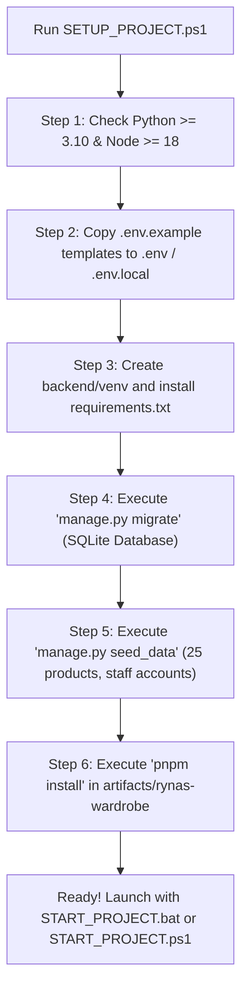

# 👗 Ryna's Wardrobe — Master 1-Click Setup & Startup Commands

> **Zero-Assumption Setup Guide**: Everything required to install, configure, migrate, seed, and run Ryna's Wardrobe in a single copy-paste command.

---

## ⚡ 1. THE 1-CLICK POWERSHELL SETUP COMMAND (RUN ONCE ON NEW LAPTOP)

Paste this single line into **Windows PowerShell**. It automatically checks tools, copies `.env` templates, creates the Python virtual environment, installs backend dependencies, runs migrations, seeds catalog and staff accounts, and installs frontend npm packages in **one go**:

```powershell
powershell -ExecutionPolicy Bypass -File .\SETUP_PROJECT.ps1
```

### Or Single-Line Inline PowerShell Command (Runs from ANY directory):
```powershell
$R = if (Test-Path ".\artifacts\rynas-wardrobe") { (Get-Location).Path } elseif (Test-Path "$PSScriptRoot\artifacts\rynas-wardrobe") { $PSScriptRoot } else { "C:\Users\USER\OneDrive\Desktop\Anastasia's Wardrobe" }; powershell -ExecutionPolicy Bypass -File "$R\SETUP_PROJECT.ps1"
```

---

## 🖱️ 2. DOUBLE-CLICK LAUNCHERS (ZERO TERMINAL TYPING)

Prefer using your mouse? You can run everything directly from **File Explorer**:

| Task | File to Double-Click | What It Does |
| :--- | :--- | :--- |
| **Initial Setup** | [`SETUP_PROJECT.bat`](file:///c:/Users/USER/OneDrive/Desktop/Anastasia's%20Wardrobe/SETUP_PROJECT.bat) | Installs all Python + Node libraries, prepares `.env`, migrates database, and seeds accounts. |
| **Start Application** | [`START_PROJECT.bat`](file:///c:/Users/USER/OneDrive/Desktop/Anastasia's%20Wardrobe/START_PROJECT.bat) | Clears ports, boots Django (8000), boots Next.js (3000), and opens your browser. |

---

## 🚀 3. THE 1-LINE START COMMAND (TO RUN SERVERS DAILY)

Once setup is complete, paste this into PowerShell whenever you want to start the app:

```powershell
powershell -ExecutionPolicy Bypass -File .\START_PROJECT.ps1
```

### Or Direct Inline PowerShell Launcher:
```powershell
$R = "C:\Users\USER\OneDrive\Desktop\Anastasia's Wardrobe"; Get-NetTCPConnection -LocalPort 3000, 8000 -ErrorAction SilentlyContinue | ForEach-Object { Stop-Process -Id $_.OwningProcess -Force -ErrorAction SilentlyContinue }; Start-Process powershell -WorkingDirectory "$R\backend" -ArgumentList "-ExecutionPolicy", "Bypass", "-NoExit", "-Command", "Write-Host '--- DJANGO BACKEND (PORT 8000) ---' -ForegroundColor Yellow; & '.\venv\Scripts\python.exe' manage.py runserver 127.0.0.1:8000"; Start-Process powershell -WorkingDirectory "$R\artifacts\rynas-wardrobe" -ArgumentList "-ExecutionPolicy", "Bypass", "-NoExit", "-Command", "Write-Host '--- NEXT.JS FRONTEND (PORT 3000) ---' -ForegroundColor Green; pnpm run dev"; Start-Sleep -Seconds 3; Start-Process "http://localhost:3000"
```

---

## 🌐 4. LOCAL WEB ADDRESSES & PRE-SEEDED CREDENTIALS

| Service | URL | Role / Permissions | Default Credentials |
| :--- | :--- | :--- | :--- |
| **Storefront** | [http://localhost:3000](http://localhost:3000) | Public customer catalog & shopping bag | *No sign-in required* |
| **Customer Account** | [http://localhost:3000/account](http://localhost:3000/account) | Patron order history, tracking & addresses | `maya.kapoor@example.com` / `Maya@123` |
| **Staff Console** | [http://localhost:3000/staff](http://localhost:3000/staff) | Orders queue, inquiries, stock management | `USER` / `Maya@123` |
| **Orders Staff** | [http://localhost:3000/staff](http://localhost:3000/staff) | Order fulfillment & live status changes | `staff_orders` / `Maya@123` |
| **Concierge Staff**| [http://localhost:3000/staff](http://localhost:3000/staff) | Customer inquiries & SMTP email replies | `staff_concierge` / `Maya@123` |
| **Django Admin** | [http://127.0.0.1:8000/admin/](http://127.0.0.1:8000/admin/) | Master administration database portal | `USER` / `Maya@123` |

> [!IMPORTANT]
> **Browser URL Rule:** Never type `http://0.0.0.0:8000` into your browser. In Chrome/Edge, `0.0.0.0` will result in `ERR_ADDRESS_INVALID`. Always access backend services via `http://127.0.0.1:8000` or `http://localhost:8000`.

---

## 📋 5. WHAT `SETUP_PROJECT.ps1` DOES BEHIND THE SCENES


