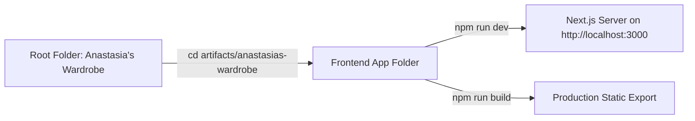
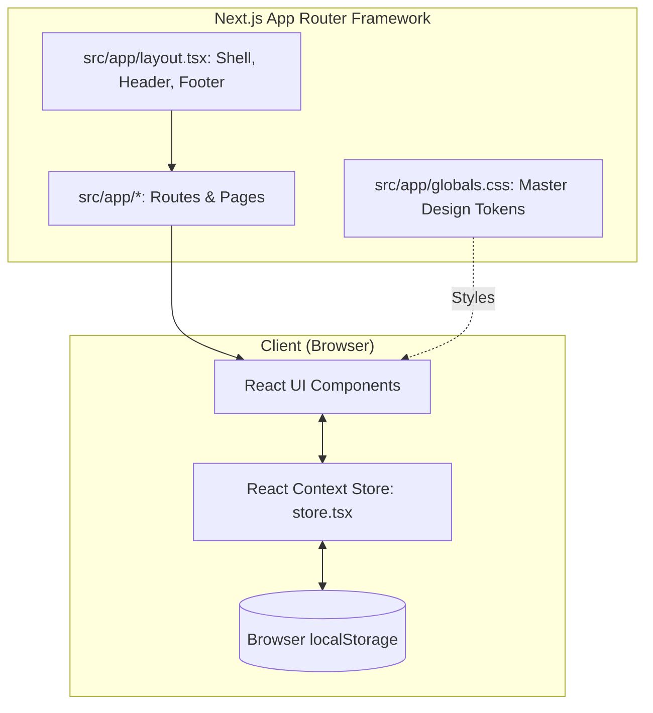
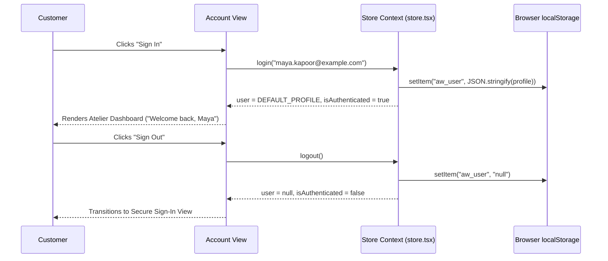

# Anastasia's Wardrobe — Developer Reference & Architecture Study Guide

> **Welcome to the Project Study Guide!**  
> This handbook is designed as a **one-on-one companion** to explain every command, concept, architectural pattern, and terminology used in Anastasia's Wardrobe. You can keep this open and refer to it anytime while development progresses.

---

## Table of Contents
1. [Quick Answers: Why Did Your Terminal Command Show an Error?](#1-quick-answers-why-did-your-terminal-command-show-an-error)
2. [Terminal Cheatsheet (PowerShell vs. CMD)](#2-terminal-cheatsheet-powershell-vs-cmd)
3. [System Architecture & Tech Stack](#3-system-architecture--tech-stack)
4. [Folder & Directory Blueprint](#4-folder--directory-blueprint)
5. [Core Concepts & Terminology Dictionary](#5-core-concepts--terminology-dictionary)
6. [Design System & CSS Styling Mechanics](#6-design-system--css-styling-mechanics)
7. [State Management & Data Flow Architecture](#7-state-management--data-flow-architecture)
8. [Feature-by-Feature Functional Guide](#8-feature-by-feature-functional-guide)

---

## 1. Quick Answers: Why Did Your Terminal Command Show an Error?

When you ran the commands, three specific things happened:

### Error 1: `listen EADDRINUSE: address already in use 0.0.0.0:3000`
* **What it means**: `EADDRINUSE` stands for **Error: Address Already In Use**. 
* **Why it happened**: Next.js is **already running** in a background process serving the website on port `3000`! You can verify this right now by opening [http://localhost:3000](http://localhost:3000) in your browser. Two programs cannot listen to the exact same port simultaneously.
* **How to fix if you want to run it manually in your own terminal window**:
  1. Kill the process currently holding port 3000:
     ```powershell
     Stop-Process -Id (Get-NetTCPConnection -LocalPort 3000).OwningProcess -Force
     ```
  2. Then run:
     ```powershell
     npm run dev
     ```
  *Or simply run on another port (e.g., 3001)*:
  ```powershell
  npx next dev --port 3001
  ```

---

### Error 2: `cd /d "..." : A positional parameter cannot be found...`
* **What it means**: `/d` is an old MS-DOS / Command Prompt (CMD) flag used to change drives (e.g. from `C:` to `D:`).
* **Why it happened**: You were in **PowerShell**, not Command Prompt (notice the `PS` prompt at the beginning of the line: `PS C:\...>`). PowerShell does not recognize `/d`.
* **How to fix in PowerShell**: Just use `cd "path"` or `Set-Location "path"` without `/d`:
  ```powershell
  Set-Location "c:\Users\USER\OneDrive\Desktop\Anastasia's Wardrobe\artifacts\anastasias-wardrobe"
  ```

---

### Error 3: `Cannot find path '...\artifacts\anastasias-wardrobe\artifacts\anastasias-wardrobe'`
* **What it means**: You tried to `cd "artifacts\anastasias-wardrobe"` when you were **already** inside `artifacts\anastasias-wardrobe`!
* **How to check where you are**: Look at the text before the `>` cursor in PowerShell:
  * If it says `PS C:\Users\USER\OneDrive\Desktop\Anastasia's Wardrobe>`, you are in the **Root**.
  * If it says `PS C:\Users\USER\OneDrive\Desktop\Anastasia's Wardrobe\artifacts\anastasias-wardrobe>`, you are **already in the frontend folder**! You only need to type `npm run dev`.

---

## 2. Terminal Cheatsheet (PowerShell vs. CMD)



### Essential Navigation Commands

| Action | PowerShell Command | Command Prompt (CMD) | Explanation |
| :--- | :--- | :--- | :--- |
| **Check Current Folder** | `Get-Location` or `pwd` | `cd` | Tells you where your terminal cursor currently is. |
| **Go to Frontend Folder** | `Set-Location "c:\Users\USER\OneDrive\Desktop\Anastasia's Wardrobe\artifacts\anastasias-wardrobe"` | `cd /d "c:\Users\USER\OneDrive\Desktop\Anastasia's Wardrobe\artifacts\anastasias-wardrobe"` | Jumps directly to the project folder. Double quotes protect spaces and apostrophes (`'`). |
| **Go Up One Folder** | `cd ..` | `cd ..` | Moves from `anastasias-wardrobe` back to `artifacts`. |
| **Start Dev Server** | `npm run dev` | `npm run dev` | Runs the development server with live reload. |
| **Kill Port 3000 (Windows)** | `Stop-Process -Id (Get-NetTCPConnection -LocalPort 3000).OwningProcess -Force` | `for /f "tokens=5" %a in ('netstat -aon ^| findstr :3000') do taskkill /f /pid %a` | Frees up port 3000 if another process was left running. |
| **Run on Port 3001** | `npx next dev --port 3001` | `npx next dev --port 3001` | Avoids port conflicts completely. |

---

## 3. System Architecture & Tech Stack



### 1. Framework: Next.js 16 (App Router)
* **What it is**: A modern React meta-framework.
* **App Router (`src/app/`)**: Routes are defined by directories. 
  * `src/app/account/page.tsx` $\rightarrow$ `/account`
  * `src/app/checkout/page.tsx` $\rightarrow$ `/checkout`
  * `src/app/shipping-returns/page.tsx` $\rightarrow$ `/shipping-returns`
* **Static Export (`output: "export"`)**: Configured in `next.config.mjs` to generate blazing-fast pre-rendered HTML/CSS/JS without requiring a complex backend server.

### 2. Language: TypeScript
* Adds static typing to JavaScript. Catches bugs before you run the code (e.g. preventing missing object properties like `order.items`).

### 3. Styling: Custom CSS Design System with Tailwind Compatibility
* **File**: `src/app/globals.css`
* Inspired by the luxury boutique Figma specification, using custom design tokens (`#713A48` Burgundy, `#302B28` Ink, `#F8F5EF` Linen Paper, `#3E6545` Forest Green).

### 4. Client State: React Context API + LocalStorage Persistence
* **File**: `src/lib/store.tsx`
* Manages global shopping bag (`cart`), `wishlist`, authenticated `user` profile, and dynamic currency conversions.

---

## 4. Folder & Directory Blueprint

```
Anastasia's Wardrobe/
│
├── artifacts/
│   └── anastasias-wardrobe/           <--- [PRIMARY FRONTEND APPLICATION]
│       ├── package.json               <--- Project metadata & run scripts
│       ├── next.config.mjs            <--- Next.js settings (output: export)
│       ├── tsconfig.json              <--- TypeScript configuration & path aliases (@/*)
│       │
│       ├── public/                    <--- Static assets (logos, garment imagery)
│       │   └── images/
│       │
│       └── src/                       <--- Source Code
│           ├── app/                   <--- Next.js App Router Pages
│           │   ├── layout.tsx         <--- Global root shell (Fonts, Header, Footer)
│           │   ├── globals.css        <--- Design System CSS tokens & utility rules
│           │   ├── page.tsx           <--- Home / Landing page
│           │   ├── account/page.tsx   <--- Customer Account Portal (/account)
│           │   ├── checkout/page.tsx  <--- Checkout flow (/checkout)
│           │   ├── wishlist/page.tsx  <--- Saved garments (/wishlist)
│           │   ├── search/page.tsx    <--- Live search & filter (/search)
│           │   └── ... (support, size-guide, shipping-returns)
│           │
│           ├── components/            <--- Modular Reusable UI Components
│           │   ├── account/           <--- OrdersList, OrderDetailModal, ProfileView, etc.
│           │   ├── catalog/           <--- ProductDetailView, FilterDrawer, etc.
│           │   ├── home/              <--- HeroBanner, AtelierStory, NewArrivals, etc.
│           │   ├── layout/            <--- Header, Footer, MobileDrawer
│           │   └── ui/                <--- Atomic UI primitives (Buttons, Badges, Modals)
│           │
│           ├── config/                <--- Application constants & currencies (INR ₹)
│           ├── lib/                   <--- Core libraries & Store (src/lib/store.tsx)
│           └── types/                 <--- TypeScript interfaces (account.ts, product.ts)
```

---

## 5. Core Concepts & Terminology Dictionary

### Development & Networking Terms

#### Port (`:3000`)
* A port is a designated communication channel on your computer. When you run `npm run dev`, Next.js claims port `3000` so web browsers can connect to `http://localhost:3000`.

#### `localhost` / `127.0.0.1`
* "This computer". A special domain name pointing back to your own machine for local testing without internet broadcasting.

#### Daemon Process
* A background program that continues running quietly without monopolizing your active terminal window. (This is how our automated dev server runs in the IDE background).

#### PID (Process ID)
* A unique integer number that Windows assigns to every active program. When you run `Stop-Process`, Windows uses the PID to stop the process.

---

### React & Next.js Terms

#### Client Component (`"use client"`)
* Placed at the top of a file (e.g., `"use client";`). It tells Next.js that this component runs in the user's browser, enabling interactive features like `useState`, `useEffect`, button clicks, and `localStorage`.

#### Hydration
* The process where React attaches JavaScript event listeners (clicks, inputs, toggles) to the static HTML received from the server so the page becomes interactive.

#### React Hook (`useState`, `useEffect`, `useRef`)
* **`useState`**: Stores local component data that triggers a visual re-render when modified (e.g. `isOpen` for a modal).
* **`useEffect`**: Runs code when a component mounts, unmounts, or when specific dependencies change (e.g. syncing with `localStorage`).
* **`useRef`**: Holds a direct reference to a raw HTML DOM element (e.g. grabbing the scrollable `<div>` to measure or control its scroll offset).

#### Context API & Provider (`<StoreProvider>`)
* A React mechanism to share data across the entire application without passing props manually down through dozens of components.

---

### Layout & CSS Mechanics (Why the Modal Bug Happened)

```mermaid
graph TD
    subgraph Bug ["Previous Behavior (Missing CSS Utilities)"]
        B1["Modal child had no max-height constraint (~1200px tall)"]
        B2["Parent used: flex items-center (vertically centered in 706px viewport)"]
        B3["Top half pushed into negative coordinates: Y = -247px"]
        B4["Header, Close 'X', and Confirmed step clipped off-screen!"]
        B1 --> B2 --> B3 --> B4
    end

    subgraph Fix ["Fixed Behavior (Added .max-h-[90vh], .min-h-0, .overflow-y-auto)"]
        F1["Modal container strictly capped: max-height: min(90vh, calc(100vh - 3rem))"]
        F2["Inner body has min-height: 0 and overflow-y: auto"]
        F3["Header & Footer stay permanently docked"]
        F4["Inner garment parcel & tracking steps scroll smoothly from Top 0!"]
        F1 --> F2 --> F3 --> F4
    end
```



#### Flexbox (`display: flex`)
* A CSS layout model that distributes space among items.
* `items-center`: Vertically centers children. **Gotcha**: If a child is taller than its parent, vertical centering pushes the top half *above* the screen where the user cannot see it!
* `min-h-0` (`min-height: 0`): Crucial for flex children with internal scrollbars. By default, flex items have `min-height: auto`, which refuses to shrink smaller than their content unless you explicitly set `min-height: 0`.

---

## 6. Design System & CSS Styling Mechanics

Anastasia's Wardrobe uses a luxury bespoke Indian aesthetic:

| Token Name | Hex Code | Visual Swatch Role | Where It's Used |
| :--- | :--- | :--- | :--- |
| **`--color-burgundy`** | `#713A48` | Primary Wine Accent | Action buttons, active badges, crests, brand links |
| **`--color-burgundy-dark`** | `#582B37` | Deep Burgundy | Button hover states |
| **`--color-ink`** | `#302B28` | Charcoal Ink | Headings, garment titles, primary typography |
| **`--color-muted`** | `#69615B` | Taupe / Slate | Secondary subtitles, tracking courier dates, labels |
| **`--bg-paper`** | `#F8F5EF` | Warm Linen Canvas | Overall page background |
| **`--bg-porcelain`** | `#FFFDFA` | Ivory Porcelain | Modal cards, elevated garment tiles |
| **`--color-border`** | `#D8CFC6` | Soft Border Rule | Card boundaries, dividers, table borders |
| **`--color-accent-forest`** | `#3E6545` | Atelier Forest Green | "Delivered" badges, complimentary shipping tags |

---

## 7. State Management & Data Flow Architecture

The heart of dynamic data is [`src/lib/store.tsx`](file:///c:/Users/USER/OneDrive/Desktop/Anastasia's%20Wardrobe/artifacts/anastasias-wardrobe/src/lib/store.tsx):



* **Persistence**: Every change to Cart, Wishlist, or User profile is saved in the browser's `localStorage` under `aw_user`, `aw_cart`, `aw_wishlist`. Even if the customer refreshes the page, their state is preserved!

---

## 8. Feature-by-Feature Functional Guide

### 1. Customer Account & Atelier Portal (`/account`)
* **Tabs**:
  1. **Orders & Returns**: Lists past orders (`AW-41322`, `AW-84192`). Includes status badges ("Preparing", "Delivered"), item thumbnails, and action buttons.
  2. **Address Book**: View and edit delivery destinations (Mumbai, Delhi) with standard Indian postal formats.
  3. **Profile & Privileges**: Membership tier status (Privilege Member), contact info, and "Sign Out" button.
* **Order Receipt Modal (`OrderDetailModal.tsx`)**:
  * Shows dispatch milestones: **Confirmed $\rightarrow$ Prepared $\rightarrow$ Dispatched $\rightarrow$ Delivered**.
  * Displays courier tracking number (e.g. `BD-22294160`), live tracking expander, item breakdown, and price calculations (GST 12% included).
* **Return & Exchange Workflow (`ReturnRequestModal.tsx`)**:
  * Allows customer to request doorstep pickup, choose between **Size Exchange**, **Store Credit (+10% bonus)**, or **Original Payment Refund**.

---

### Pro-Tip for Daily Development
Whenever you open your terminal to run the frontend, remember this 2-step routine:
1. Make sure your terminal prompt ends in `\artifacts\anastasias-wardrobe>`.
2. Type `npm run dev` and press Enter. That's it!
